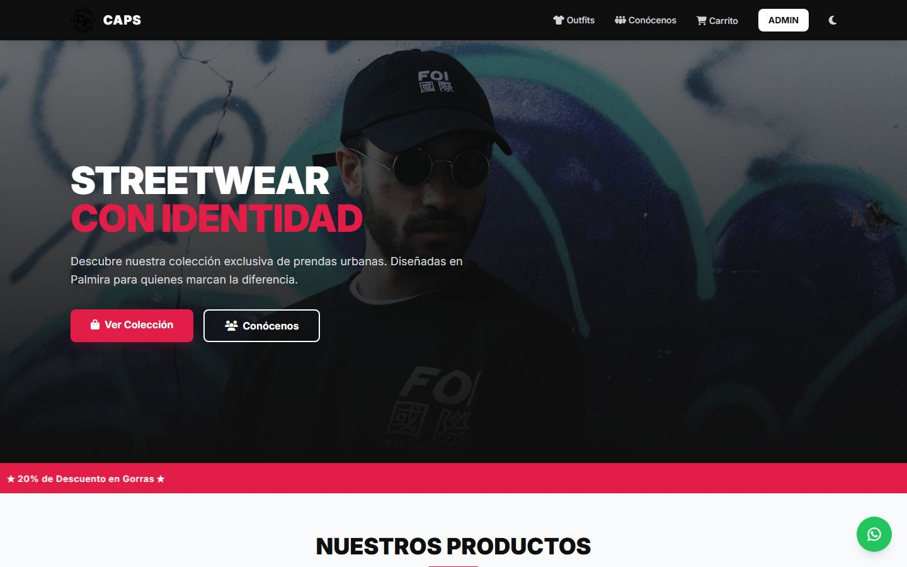
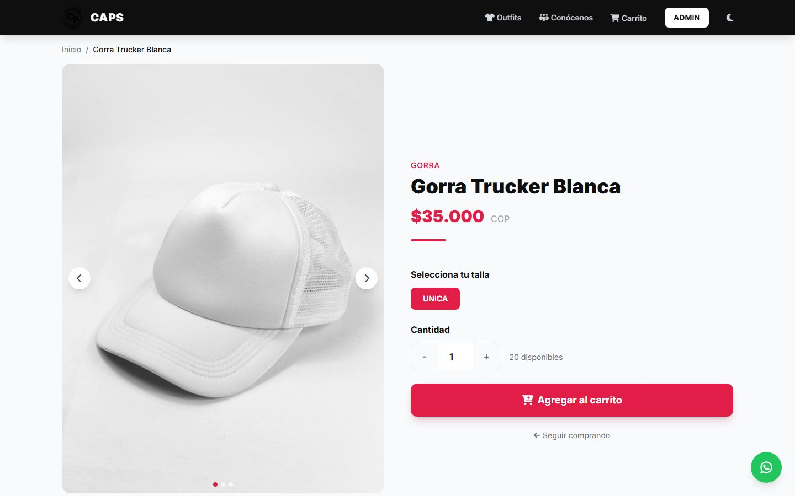
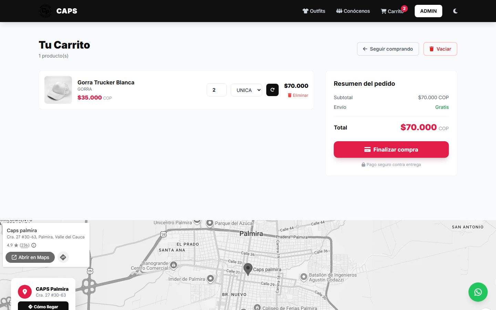
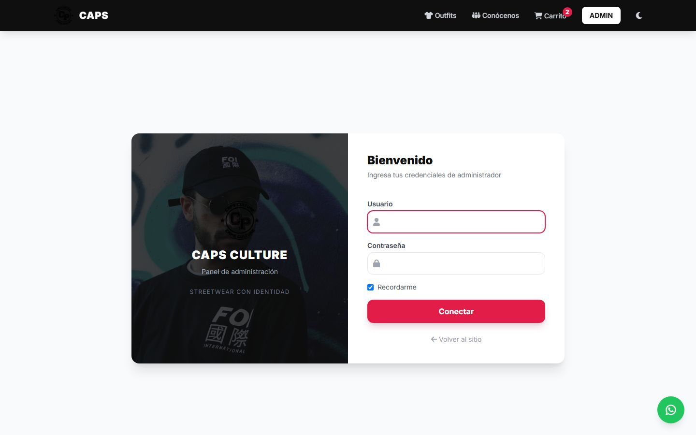
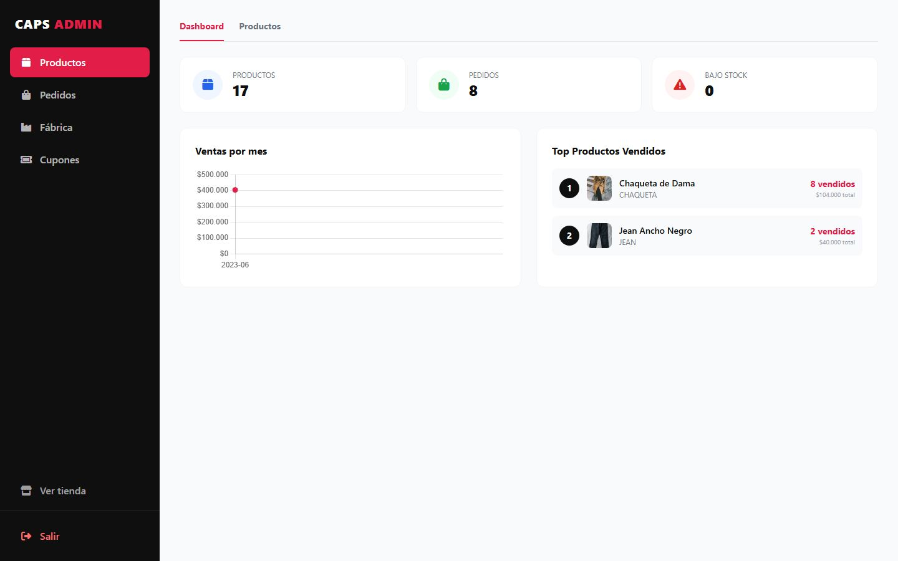

<div align="center">

# 🛍️ CAPS Culture - E-commerce Platform

[](https://php.net)
[](https://tailwindcss.com)
[](https://mysql.com)
[](https://getcomposer.org)
[](https://ddev.com)

**Plataforma de e-commerce full-stack con pasarela de pagos, panel administrativo y gestión de inventario.**

[📸 Ver Demo](#capturas-de-pantalla) • [🚀 Instalación](#instalación-rápida) • [📚 Documentación](#documentación) • [⚡ Características](#características-principales)

</div>

---

## 📸 Capturas de Pantalla

<div align="center">

| 🏠 Página Principal | �️ Detalle de Producto | � Carrito |
|:---:|:---:|:---:|
|  |  |  |
| *Catálogo con búsqueda predictiva* | *Galería con carrusel de fotos* | *Checkout con cupones* |

| 🔐 Login Admin | 📊 Panel Admin |
|:---:|:---:|
|  |  |
| *Acceso seguro con CSRF* | *Dashboard con métricas y top productos* |

</div>

> ✅ Capturas actualizadas - Octubre 2026

---

## ⚡ Características Principales

### 🛍️ **Cliente (Frontend)**
- ✅ **Catálogo dinámico** con filtros por categoría, precio y talla
- ✅ **Búsqueda predictiva** con autocompletado en tiempo real
- ✅ **Carrito persistente** vía sesiones PHP
- ✅ **Checkout optimizado** con validación de cupones de descuento
- ✅ **Pasarela de pagos** integrada (Wompi - Colombia)
- ✅ **Dark mode** toggle con persistencia local
- ✅ **Diseño responsive** con TailwindCSS

### 🔐 **Administrador (Panel)**
- ✅ **Dashboard** con métricas de ventas y gráficos Chart.js
- ✅ **Gestión de productos** CRUD completo con upload de imágenes
- ✅ **Gestión de pedidos** con cambio de estados y calendario mensual
- ✅ **Exportar pedidos** a CSV
- ✅ **Gestión de cupones** (descuentos por porcentaje o valor fijo)
- ✅ **Notificaciones por email** al recibir nuevos pedidos

### 🛡️ **Seguridad**
- ✅ **CSRF tokens** en todos los formularios
- ✅ **Prepared statements** (PDO) - protección contra SQL Injection
- ✅ **Sanitización de input** contra XSS
- ✅ **Validación de archivos** (uploads con mime-type check)
- ✅ **Password hashing** con `password_hash()`
- ✅ **Session security** con `session_regenerate_id()`

---

## 🛠️ Stack Tecnológico

### **Backend**
```
PHP 8.2+      → Lenguaje principal
PDO           → Database abstraction layer
Composer      → Gestión de dependencias
PHPMailer     → Envío de emails
```

### **Frontend**
```
TailwindCSS   → Framework CSS utilitario
Vanilla JS    → Interactividad (ES6+)
Chart.js      → Gráficos en dashboard
```

### **DevOps & Tools**
```
DDEV          → Entorno de desarrollo Docker-based
PHPUnit       → Testing de helpers
Git           → Control de versiones
```

---

## 🏗️ Arquitectura

```
Webcaps/
├── public/              # Document root (front controller)
│   ├── index.php         # Landing page
│   ├── api/              # Endpoints REST
│   └── panel/            # Proxies del panel admin
│
├── src/                  # Código fuente (MVC)
│   ├── Models/           # Capa de datos (Productos, Pedidos, etc.)
│   ├── Services/         # Lógica de negocio (Wompi, Email)
│   └── Helpers/          # Utilidades (Database, Csrf, Validator)
│
├── database/
│   └── migrations/       # Scripts de migración de BD
│
├── templates/            # Componentes reutilizables (header, footer)
├── config/               # Configuración (gitignored)
└── tests/                # Tests unitarios (PHPUnit)
```

### **Patrones Implementados**
- 🎨 **MVC (Model-View-Controller)**
- 🔌 **Front Controller Pattern** (`public/` como único punto de entrada)
- 🏭 **Lazy Loading** de dependencias
- 🔐 **Repository Pattern** para acceso a datos

---

## 🚀 Instalación Rápida

### **Opción 1: DDEV (Recomendado)**

```bash
# 1. Clonar repositorio
git clone https://github.com/JuanDRK/Webcaps.git
cd Webcaps

# 2. Configurar DDEV (primera vez)
ddev config --project-type=php --docroot=public --create-docroot
ddev start

# 3. Instalar dependencias
ddev composer install

# 4. Configurar entorno
cp config/config.example.ini config/config.ini
# Editar config.ini con credenciales de DDEV:
# dns="mysql:host=db;dbname=db"
# usuario="db"
# clave="db"

# 5. Importar base de datos
ddev import-db --src=webcaps.sql

# 6. Ejecutar migraciones
ddev php database/migrations/migracion_cupones.php
ddev php database/migrations/migracion_fotos_producto.php
ddev php database/migrations/migracion_pedidos_descuento.php

# 7. Abrir proyecto
ddev launch
```

### **Opción 2: Docker (sin DDEV)**

Si tienes Docker Desktop pero no DDEV, puedes levantar el stack con dos contenedores:

```bash
# 1. Construir la imagen PHP (Apache + extensiones + Composer)
docker build -t webcaps-php docker/

# 2. Crear red y levantar MariaDB + Web
docker network create webcaps-net
docker run -d --name webcaps-db --network webcaps-net --network-alias db \
  -e MARIADB_ROOT_PASSWORD=root -e MARIADB_DATABASE=db \
  -e MARIADB_USER=db -e MARIADB_PASSWORD=db mariadb:11.8
docker run -d --name webcaps-web --network webcaps-net -p 8088:80 \
  -v ${PWD}:/var/www/html webcaps-php

# 3. Dependencias, BD y migraciones
docker exec webcaps-web composer install
docker exec -i webcaps-db mariadb -udb -pdb db < webcaps.sql
docker exec webcaps-web sh -c 'for f in database/migrations/*.php; do php "$f"; done'

# 4. Abrir http://localhost:8088
```

> El `config.ini` del repo apunta a `host=db` con credenciales `db`/`db`, que coincide con el contenedor MariaDB. El archivo `webcaps.sql` está en `.gitignore` (datos sensibles) — consíguelo del equipo o genera tu propio dump.

### **Opción 3: XAMPP/WAMP**

```bash
# 1. Copiar a htdocs
cd C:\xampp\htdocs
git clone https://github.com/JuanDRK/Webcaps.git

# 2. Instalar dependencias
cd Webcaps
composer install

# 3. Configurar
# Copiar config/config.example.ini → config/config.ini
# Editar con: host=localhost, user=root, pass=""

# 4. Crear BD en phpMyAdmin
# Nombre: webcaps
# Importar: webcaps.sql
```

### **Accesos por defecto**

| URL | Descripción |
|-----|-------------|
| `http://webcaps.ddev.site` | Página principal |
| `http://webcaps.ddev.site/acceso.php` | Panel admin |
| `http://webcaps.ddev.site:8026` | Mailpit (emails capturados) |

---

## 📚 API Endpoints

### **Productos**
```http
GET  /api/productos.php          # Listar todos
GET  /api/productos.php?id=1     # Obtener uno
POST /api/productos.php          # Crear (admin)
```

### **Búsqueda**
```http
GET /api/busqueda.php?q=gorra    # Búsqueda predictiva
```

### **Cupones**
```http
POST /api/validar_cupon.php      # Validar cupón
# Body: { "codigo": "BIENVENIDO", "total": 50000 }
```

### **Pagos (Wompi)**
```http
POST /api/wompi_tokenizar.php    # Tokenizar tarjeta
POST /api/wompi_transaccion.php  # Procesar pago
```

---

## 🧪 Testing

```bash
# Ejecutar tests unitarios
ddev php vendor/bin/phpunit

# Tests específicos
ddev php vendor/bin/phpunit tests/Helpers/CsrfTest.php
```

---

## 📋 Roadmap / Futuras Mejoras

- [ ] **Testing end-to-end** con Playwright
- [ ] **CI/CD pipeline** con GitHub Actions
- [ ] **API documentation** con Swagger/OpenAPI
- [ ] **Cache layer** con Redis
- [ ] **Multi-idioma** (i18n)
- [ ] **Progressive Web App** (PWA)
- [ ] **Reportes avanzados** con filtros de fecha
- [ ] **Sistema de reseñas** de productos

---

## 🤝 Contribuir

1. Fork el proyecto
2. Crea tu feature branch (`git checkout -b feature/nueva-funcionalidad`)
3. Commit tus cambios (`git commit -am 'Add: nueva funcionalidad'`)
4. Push a la branch (`git push origin feature/nueva-funcionalidad`)
5. Abre un Pull Request

---

## 👨‍💻 Autor

**JuanDRK** - *Full Stack Developer*

- GitHub: [@JuanDRK](https://github.com/JuanDRK)

---

## 📄 Licencia

Este proyecto está bajo la Licencia MIT - ver el archivo [LICENSE](LICENSE) para detalles.

---

<div align="center">

⭐ **Si te gustó este proyecto, dale una estrella!** ⭐

Hecho con ❤️ y ☕ en Colombia

</div>
